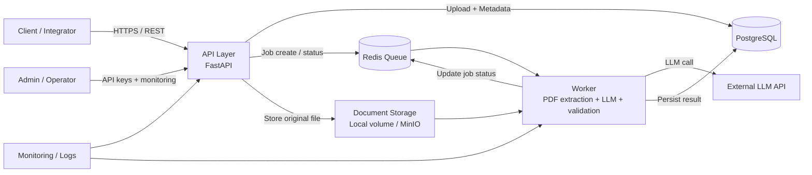
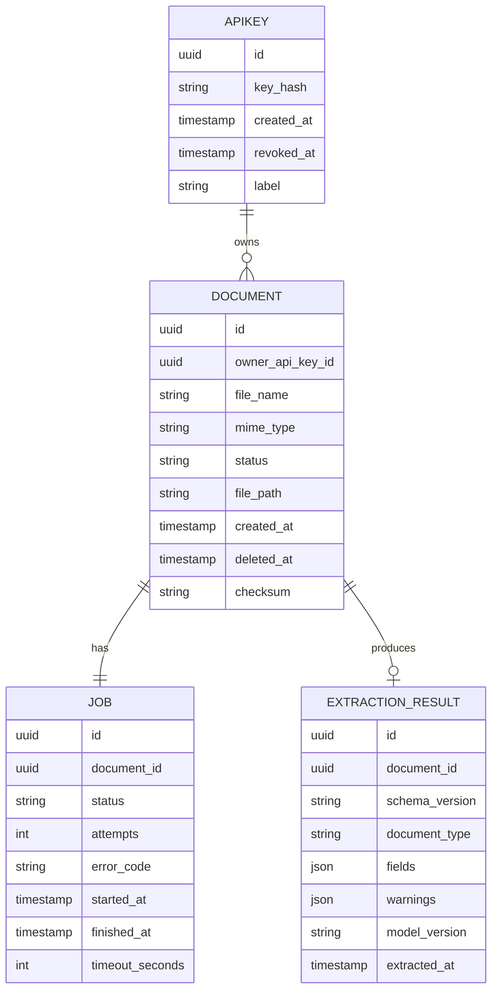

# Architektur – Document Processing API

## 1. Ziel und Rahmen

Die Architektur dient dem MVP nach den Anforderungen in [docs/requirements.md](requirements.md) und [docs/mvp.md](mvp.md):

- Upload eines PDF-Rechnungsdokuments
- asynchrone Verarbeitung mit Job-Status
- Extraktion der Pflichtfelder mit LLM
- Schema-validierte Ergebnisantwort
- sichere Authentifizierung und kontrollierte Löschung
- realisierbare Entwicklung in einem Semester ohne Overengineering

Die Architektur ist bewusst auf einen konkreten Anwendungsfall ausgerichtet: Rechnungsextraktion aus Text-PDFs mit einfacher, nachvollziehbarer Infrastruktur.

---

## 2. Architekturvarianten

### Variante A: Modularer Monolith mit Async Worker

Beschreibung:

- Eine zentrale Python-API (`FastAPI`) übernimmt HTTP-Anfragen
- Ein Worker-Prozess verarbeitet Jobs asynchron
- PostgreSQL speichert Dokumente, Jobs und Ergebnisse
- Redis dient als Queue und Caching
- Das Ergebnis wird nach erfolgreicher Validierung persistiert

Vorteile:

- geringere Komplexität als Microservices
- einfacher zu entwickeln, testen und debuggen
- für Teamgröße und Semesterprojekt gut geeignet
- klare Verantwortlichkeiten im gleichen Codebase
- schnelle Iteration bei kleineren Änderungen

Nachteile:

- Skalierung ist nur auf Prozessebene möglich
- bei sehr hoher Last müssen Worker und API getrennt skalieren
- weniger isolierte Fehlergrenzen als in einer verteilten Architektur

### Variante B: Serverless / Event-Driven mit getrennten Services

Beschreibung:

- API als Function/HTTP-Service
- Worker ausgelagert in separate Functions oder Container
- Queue/Events für Job-Übergabe
- separate Storage-Services für Dokumente und Ergebnisse
- ggf. Cloud-Objektspeicher und managed Postgres

Vorteile:

- starke Isolierung einzelner Verantwortlichkeiten
- automatische Skalierung für Lastspitzen
- gut für spätere Erweiterung in Richtung hohe Parallelität

Nachteile:

- deutlich mehr Betriebsaufwand
- erhöhte Kopplung an Cloud-Services
- schwierigere lokale Entwicklung und Testbarkeit
- für den MVP und das Semesterprojekt technisch und organisatorisch zu aufwändig

### Vergleich

| Kriterium | Modularer Monolith | Serverless / Event-Driven |
|---|---|---|
| Implementierungsaufwand | Niedrig | Hoch |
| Verständnis für Team | Hoch | Mittel |
| Betriebskomplexität | Niedrig | Hoch |
| Testbarkeit | Hoch | Mittel |
| Skalierbarkeit | Gut genug für MVP | Sehr gut |
| Eignung für Semesterprojekt | Sehr gut | Schlecht bis mittel |
| Kosten im MVP | Niedrig | Mittel bis hoch |

### Entscheidung

Die Architektur des MVPs folgt Variante A: modularer Monolith mit klar getrenntem Worker. Diese Entscheidung ist auf die Anforderungen aus [docs/requirements.md](requirements.md) abgestimmt: Das Team muss die Architektur erklären, verstehen und innerhalb der gegebenen Zeit umsetzen können. Die gewünschte Einfachheit hat Priorität vor hypothetischer Skalierung.

---

## 3. Technologiewahl und Begründung

### 3.1 Backend

- Python 3.12
- FastAPI
- Pydantic v2 für Request/Response-Validierung und JSON-Schema-Modelle

Begründung:

- schnelle API-Entwicklung mit klarer Typisierung
- gute Unterstützung für OpenAPI und automatische Dokumentation
- hohe Produktivität für kleine Teams
- gut geeignet für LLM-Integrationen und Validierungslogik

### 3.2 Asynchrone Verarbeitung

- Redis als Queue / Job-Broker
- Celery oder RQ als Worker-Framework (MVP-Entscheidung: Celery wegen besserer Standards und Monitoring)

Begründung:

- erfüllt FR-02 und FR-03
- Verarbeitung kann asynchron laufen, ohne den Upload-Request zu blockieren
- einfacher als vollständige Message-Oriented Architecture mit eigener Broker-Topologie
- robust genug für das Semesterprojekt

### 3.3 Persistenz

- PostgreSQL als primäre Datenspeicherbank
- Redis als Job-Queue und Kurzzeit-Cache

Begründung:

- PostgreSQL behandelt Jobs, Dokument-Metadaten, API-Key-Informationen und resultierende Payloads zuverlässig
- Transaktionen sind für Statuswechsel, Löschung und Konsistenz wichtig
- Redis ist für Jobnutzung und Status-Updates ausreichend, ohne volle Enterprise-Queue-Komplexität

### 3.4 Datei- und Dokumentenspeicherung

- lokaler Dateisystemordner oder objektbasierter Speicher (MinIO in Entwicklung; später S3-ähnlich)

Begründung:

- die ursprüngliche PDF muss für spätere Löschlogik und Prüfungen vorhanden sein
- MinIO oder ein einfacher lokaler Volume-Ordner ist für den MVP ausreichend
- ein object store ist leicht expandierbar, ohne sofort eine vollwertige Cloud-Architektur zu forcieren

### 3.5 LLM-Integration

- externer LLM-Anbieter über ein abstrahiertes Service-Interface
- Prompt-Versionierung und Modell-ID werden im Ergebnis mitgeführt

Begründung:

- die geschäftslogische Kernfunktion liegt in der Extraktion, nicht in der Auswahl einer bestimmten Cloud-Plattform
- ein Interface schützt vor Vendor-Lock-in und erleichtert Messung nach NFR-11 und NFR-12
- Fehlerbehandlung (`llm_unavailable`, Timeout, Retry) ist zentralisiert

### 3.6 Infrastruktur und Hosting

- Docker Compose für lokale Entwicklung und Demo-Deployment
- Reverse Proxy (Nginx/Traefik) für TLS und Routen
- optional separate VM oder kleiner Cloud-Host im MVP

Begründung:

- schnell startbar, leicht nachvollziehbar und gut für Präsentation
- kein übertriebener Infrastrukturaufwand
- erfüllt die Anforderung, dass die Architektur durch Studierende erklärt und verteidigt werden kann

---

## 4. Architekturdiagramm

Das folgende Diagramm bildet die Systemstruktur in vereinfachter Form ab und zeigt die wichtigsten Verantwortlichkeiten.



### Verantwortlichkeiten der Komponenten

- API-Layer: Authentifizierung, Upload, Statusabfrage, Ergebnisabruf, Löschlogik
- Worker: PDF-Textaufbereitung, LLM-Aufruf, Validierung, Warnungen, Timeout-Handling
- PostgreSQL: Persistenz von Dokumenten, Jobs, Ergebnissen, API-Key-Hash und Metadaten
- Redis: Job-Queue, lockartige Statuswechsel, kurze Zwischenspeicher
- Dokumentenspeicher: Original-PDFs und temporäre Artefakte
- LLM-Anbieter: Extraktion aus Text, ohne dass die API-Logik selbst die Wissenslogik enthält

---

## 5. Datenmodell

Die zentralen Entitäten sind bewusst klein und auf den MVP abgestimmt.

### 5.1 Entitäten

- Document
  - id
  - owner_api_key_id
  - file_name
  - mime_type
  - status
  - file_path
  - created_at
  - deleted_at
  - checksum

- Job
  - id
  - document_id
  - status (`queued`, `processing`, `done`, `failed`)
  - attempts
  - error_code
  - started_at
  - finished_at
  - timeout_seconds

- ExtractionResult
  - id
  - document_id
  - schema_version
  - document_type
  - fields (JSON)
  - warnings (JSON)
  - model_version
  - extracted_at

- ApiKey
  - id
  - key_hash
  - created_at
  - revoked_at
  - label

### 5.2 Beziehungen

- Ein `Document` hat genau einen zugehörigen `Job`.
- Ein `Document` hat genau ein `ExtractionResult`, sofern die Verarbeitung abgeschlossen ist.
- Ein `ApiKey` kann mehrere `Document`-Einträge besitzen.
- `Job`-Statuswechsel erfolgen über Transaktionen und werden durch die Worker-Logik bestimmt.

### 5.3 ER-Diagramm



### 5.4 Datenbankentscheidung

Das Datenmodell ist bewusst nicht auf hypothetische Mehrmandanten- oder Multiregion-Features ausgerichtet. Es enthält genau die Entitäten, die für den MVP erforderlich sind und lässt spätere Erweiterungen durch zusätzliche Tabellen oder Felder zu.

---

## 6. API-Design

Das API-Design orientiert sich an den Must-Requirements und verwendet `/v1`-Pfadpräfixe.

### 6.1 Endpoints

#### POST /v1/documents

Upload eines PDF-Dokuments.

Request:

- `multipart/form-data`
- Feld `file` mit PDF
- optional `document_type` für spätere Erweiterung, im MVP aber nicht erforderlich

Response `202 Accepted`:

```json
{
  "document_id": "d_123",
  "job_id": "j_456",
  "status": "queued"
}
```

Fehler:

- `400` fehlendes Datei-Feld
- `413` Datei zu groß
- `415` falscher Dateityp
- `422` unlesbares Dokument, `no_text_layer`, `too_many_pages`

#### GET /v1/jobs/{job_id}

Statusabfrage.

Response:

```json
{
  "job_id": "j_456",
  "document_id": "d_123",
  "status": "processing",
  "error": null
}
```

#### GET /v1/documents/{document_id}/result

Ergebnisabruf.

Erfolgsantwort `200`:

```json
{
  "document_id": "d_123",
  "document_type": "invoice",
  "schema_version": "1.0",
  "fields": {
    "invoice_number": "RE-2026-0042",
    "invoice_date": "2026-09-30",
    "supplier": "Muster GmbH",
    "currency": "EUR",
    "net_amount": 100.0,
    "tax_amount": 19.0,
    "gross_amount": 119.0
  },
  "warnings": []
}
```

Bei `queued`, `processing`, `failed`:

- `409 Conflict` mit aktuellem Status
- bei `failed` zusätzlich `error.code`

#### DELETE /v1/documents/{document_id}

Löscht Dokument, Ergebnis und Job.

Response:

- `204 No Content`
- wiederholtes Löschen liefert `404`

### 6.2 Fehlerformat

Einheitliche Fehlerantwort:

```json
{
  "error": {
    "code": "unreadable_document",
    "message": "The uploaded file could not be read as a valid PDF."
  }
}
```

Das entspricht den Anforderungen an maschinenlesbare Fehlercodes und vereinfachte Debugging-Strategien.

### 6.3 API-Designentscheidungen

- REST statt GraphQL, da das Team schnell verständliche Endpoints erzeugen will
- asynchrone Verarbeitung statt synchroner LLM-Blockierung
- Statusmodell bewusst minimal und nachvollziehbar
- Ergebniswerkzeug und Datenmodell bewusst auf Rechnung als Ausgangspunkt fokussiert

---

## 7. Architecture Decision Records (ADRs)

Die wichtigen Architekturentscheidungen sind in den ADR-Dateien dokumentiert:

- [docs/adr/ADR-001-modular-monolith.md](adr/ADR-001-modular-monolith.md)
- [docs/adr/ADR-002-postgres-redis.md](adr/ADR-002-postgres-redis.md)

Diese ADRs dokumentieren Kontext, Entscheidung, Alternativen und Konsequenzen und erfüllen damit die Anforderung, Architekturentscheidungen kritisch zu begründen.

---

## 8. AI-Unterstützung und kritische Bewertung

### 8.1 AI-gestützte Architekturideen

Für die Architektur wurden AI-gestützte Vorschläge genutzt, unter anderem:

- kritische Analyse zweier Architekturmuster
- Bewertung von Komplexität versus Erfolgsaussicht
- Vorschlag für die Auswahl zwischen Modular Monolith und Event-Driven Services
- Hinweise zu Schwachstellen in der Verarbeitungskette und beim Umgang mit LLM-Fehlern

### 8.2 Beispiel für einen AI-Input

Ein typischer Vorschlag war: "Baue die Lösung als vollständig serverless, event-driven System mit mehreren Cloud-Services auf."

### 8.3 Kritische Bewertung

Dieser Vorschlag war technisch möglich, aber für den MVP nicht passend, weil:

- die Betriebslogik deutlich komplexer und schwerer verständlich würde
- lokale Entwicklung und Demo-Laufzeit deutlich schwieriger wären
- die fachliche Kernfunktion (Extraktion aus einer Rechnung) in keiner Weise einen kompletten Cloud-Event-Stack erfordert
- das Team die Architektur in der Präsentation verteidigen muss und damit mehr Komplexität als nötig vermeiden sollte

Die AI-Generierung war deshalb hilfreich, aber nicht verbindlich. Die Architekturentscheidung wurde auf Basis von Anforderungen, Teamgröße, Entwicklungszeit und Betriebsaufwand kritisch überprüft.

### 8.4 Ergebnis der AI-Nutzung

Die AI spielte eine zentrale Rolle bei:

- Identifikation alternativer Architekturen
- Prüfung auf Overengineering
- Erkennung von technischen Risiken wie LLM-Ausfall, Queue-Nutzung und Diensttrenner
- Unterstützung bei der Erstellung der Dokumentation und ADR-Struktur

Die Auswahl wurde allerdings bewusst vom Team als technische Verantwortung geprüft und nicht blind übernommen.

---

## 9. Qualitäts- und Risikoanalyse

### Stärken der Architektur

- einfach verständlich
- passend zum MVP und zur Teamgröße
- Trennung von API, Worker und Datenhaltung
- asynchrone Verarbeitung erfüllt die Anforderungen
- gute Grundlage für spätere Erweiterungen

### Risiken

- LLM-Ausfall und Rate Limits müssen sauber behandelt werden
- Genauigkeit hängt stark davon ab, wie die Validierung und Prompt-Versionierung konfiguriert werden
- Dokument- und Log-Schutz müssen im Betrieb durch Mindeststandards sichergestellt werden
- bei hoher Last muss die Worker-Skalierung später erweitert werden

### Gegenmaßnahmen

- Retry-Strategie mit begrenzter Wiederholungsanzahl
- Fehlercodes für `llm_unavailable`, `timeout`, `extraction_invalid`
- Modell- und Prompt-Versionierung im Ergebnis
- getrennter Upload-/Verarbeitungsfluss mit klaren Zuständen

---

## 10. Fazit

Die ausgewählte Architektur ist bewusst einfach, prüfbar und umsetzbar: ein modularer Monolith mit klarer API, asynchronem Worker und persistenter Job-Verwaltung. Sie erfüllt die Anforderungen des MVP, bleibt erweiterbar und vermeidet unnötige Komplexität. Die kritische Einordnung der Alternativen und die Dokumentation in ADRs machen die Architektur nachvollziehbar und verteidigungsfähig.
